


## About me

I'm Vaishnavi, a second-year B.Tech Artificial Intelligence student at SVNIT Surat, graduating in 2029. I learn best by building: I solve data structures and algorithms problems in C++, build full-stack web projects, and explore AI, machine learning and NLP.

I enjoy hackathons, where an idea has to become a working prototype fast, and I like working in a team. My interests sit where software development, AI, problem-solving and developer tools meet. I value clean code, meaningful projects and learning through experimentation.

## Technical skills

<!-- skills:start -->

<table>
<tr>
<td><b>Languages</b></td>
<td>

</td>
</tr>
<tr>
<td><b>Frontend</b></td>
<td>

</td>
</tr>
<tr>
<td><b>Backend</b></td>
<td>

</td>
</tr>
<tr>
<td><b>Databases</b></td>
<td>

</td>
</tr>
<tr>
<td><b>Tools</b></td>
<td>

</td>
</tr>
<tr>
<td><b>Concepts</b></td>
<td>

</td>
</tr>
</table>

<!-- skills:end -->

## Featured projects

Every card says what it is: a team project, a hackathon prototype, work in progress, research, or finished work.

<!-- projects:start -->

<a href="https://github.com/Gautam-eng19/VAANI#gh-dark-mode-only"></a><a href="https://github.com/Gautam-eng19/VAANI#gh-light-mode-only"></a>
<a href="https://github.com/Gautam-eng19/PARAKH#gh-dark-mode-only"></a><a href="https://github.com/Gautam-eng19/PARAKH#gh-light-mode-only"></a>
<a href="https://github.com/vishu-py/TaskFlow#gh-dark-mode-only"></a><a href="https://github.com/vishu-py/TaskFlow#gh-light-mode-only"></a>
<picture><source media="(prefers-color-scheme: dark)" srcset="assets/card-TARAZU-dark.svg"><source media="(prefers-color-scheme: light)" srcset="assets/card-TARAZU-light.svg"></picture>
<picture><source media="(prefers-color-scheme: dark)" srcset="assets/card-SAKSHYA-dark.svg"><source media="(prefers-color-scheme: light)" srcset="assets/card-SAKSHYA-light.svg"></picture>
<a href="https://github.com/vishu-py/Hindi-Text-Restoration#gh-dark-mode-only"></a><a href="https://github.com/vishu-py/Hindi-Text-Restoration#gh-light-mode-only"></a>
<a href="https://github.com/vishu-py/leetcode-solutions-cpp#gh-dark-mode-only"></a><a href="https://github.com/vishu-py/leetcode-solutions-cpp#gh-light-mode-only"></a>
<a href="https://vishu-py.github.io/YouTube-clone/#gh-dark-mode-only"></a><a href="https://vishu-py.github.io/YouTube-clone/#gh-light-mode-only"></a>

🟣 team project &nbsp;·&nbsp; 🟡 hackathon prototype &nbsp;·&nbsp; 🔵 in progress &nbsp;·&nbsp; 🩷 research &nbsp;·&nbsp; 🟢 completed / ongoing

<!-- projects:end -->

## DSA and competitive programming

DSA is one of my main interests. I practise in C++ with the STL, focusing on problem-solving, algorithmic thinking and optimisation, and I keep my accepted solutions in a public repository sorted by topic. The numbers below refresh automatically from LeetCode. Next goal: competitive programming contests and advanced DSA.

<picture>
  <source media="(prefers-color-scheme: dark)" srcset="assets/leetcode-dark.svg">
  <source media="(prefers-color-scheme: light)" srcset="assets/leetcode-light.svg">
  
</picture>

<picture>
  <source media="(prefers-color-scheme: dark)" srcset="assets/bfs-dark.svg">
  <source media="(prefers-color-scheme: light)" srcset="assets/bfs-light.svg">
  
</picture>

<a href="https://leetcode.com/u/Vishu_py/">LeetCode profile</a> · <a href="https://github.com/vishu-py/leetcode-solutions-cpp">Solutions repository</a>

## Hackathons and activities

<picture>
  <source media="(prefers-color-scheme: dark)" srcset="assets/hackathons-dark.svg">
  <source media="(prefers-color-scheme: light)" srcset="assets/hackathons-light.svg">
  
</picture>

## Currently exploring

These are areas I'm learning, not skills I claim yet.

- **Cloud computing**: fundamentals, infrastructure and architecture, and cloud engineering concepts.
- **AI and machine learning**: fundamentals.
- **NLP and speech processing**: early experiments, such as the Hindi text reconstruction project above.
- **LLM applications**.

<picture>
  <source media="(prefers-color-scheme: dark)" srcset="assets/learning-dark.svg">
  <source media="(prefers-color-scheme: light)" srcset="assets/learning-light.svg">
  
</picture>

## GitHub statistics

<picture>
  <source media="(prefers-color-scheme: dark)" srcset="assets/stats-dark.svg">
  <source media="(prefers-color-scheme: light)" srcset="assets/stats-light.svg">
  
</picture>
<picture>
  <source media="(prefers-color-scheme: dark)" srcset="assets/langs-dark.svg">
  <source media="(prefers-color-scheme: light)" srcset="assets/langs-light.svg">
  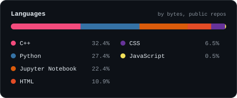
</picture>

<picture>
  <source media="(prefers-color-scheme: dark)" srcset="assets/city-dark.svg">
  <source media="(prefers-color-scheme: light)" srcset="assets/city-light.svg">
  
</picture>

<picture>
  <source media="(prefers-color-scheme: dark)" srcset="assets/snake-dark.svg">
  <source media="(prefers-color-scheme: light)" srcset="assets/snake-light.svg">
  
</picture>

## Connect with me

  

  


